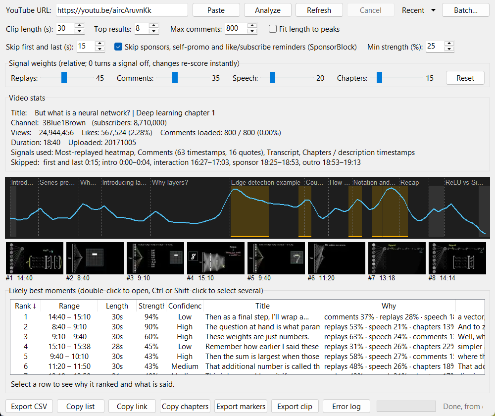

# YouTube Hotspot Finder

[](../../actions/workflows/test.yml)
[](LICENSE)


A small Python desktop app (Tkinter). Paste a YouTube URL, and it shows the video's stats and a ranked list of the time ranges most likely to be the best moments.



## Features

- Video stats: title, channel, subscribers, views, likes and comments (each as a share of views), duration, upload date
- A score timeline graph with the best moments highlighted and the video's chapters marked. Hover over it to see the time, score, range and chapter; click to open the video at that second
- A preview image for each ranked range, taken from YouTube's storyboard
- A ranked list of time ranges, for example `5:00 – 5:30`
- For each range: why it ranked (each signal's share of the score) and what is said in it
- Ranges of a fixed length, or fitted to each peak
- Adjustable signal weights that re-score instantly, saved between runs
- A progress bar while comments load, and a **Cancel** button
- A suggested title for each range, taken from what is said in it
- Skips the first and last seconds, and sponsor segments from [SponsorBlock](https://sponsor.ajay.app)
- Double-click a range to open the video at that moment, or copy a link to it
- Copy the ranges as a YouTube chapter list, or export them as markers for DaVinci Resolve or Premiere Pro
- Export the list to CSV, or copy it to the clipboard
- A cache, so a video you analyzed before opens instantly, and a **Recent** menu of those videos
- **Batch** mode: many videos, playlists or channels into one CSV
- A command-line mode with the same scoring
- An error log, opened with one click from the app

## How it finds the best moments

It blends up to four signals and uses the ones the video has:

| Signal | What it is | Default weight |
|---|---|---|
| "Most replayed" heatmap | Real viewer data from YouTube (only on some videos) | 45 |
| Comments | Times like `3:45` mentioned in comments, weighted by likes. Comments without a time that quote a distinctive 4-word phrase from the transcript count at the time it was said | 35 |
| Transcript energy | Speech density, questions, emphasis (CAPS, repeated words), hook words, `[Laughter]` and `[Applause]` in captions, phrases repeated 3+ times, and topic changes | 20 |
| Chapters | Chapter starts and timestamps in the description, boosting the 30 s after each (`0:00` is ignored) | 15 |

Weights are relative. If a signal is missing, the others are rescaled. Setting a weight to 0 turns that signal off. If the video has no heatmap, the app says so. The results are then estimates, not measured viewing data.

Each range also gets:

- **Strength:** how far the range stands above the video's typical moment, where 100% is the single best spot. Ranges below **Min strength** are hidden.
- **Confidence:** how many signals put the range in their own top quarter. High means 3 or more agree, or the heatmap and one other. Medium means 2 agree, or the heatmap alone. Low means at most one non-heatmap signal.

## Requirements

- Python 3.9 or newer, with Tkinter (included with Python on Windows and macOS)
- An internet connection

## Quick start

### Windows

1. Install Python from https://www.python.org/downloads/. During install, tick **Add python.exe to PATH**.
2. Download this repository: click **Code > Download ZIP** and unzip it, or run:

   ```
   git clone https://github.com/Ohi1997/yt-hotspot-finder.git
   ```

3. Double-click `start.bat`.

On the first run, `start.bat` installs the dependencies. This takes about a minute. After that, the app opens with no console window.

### macOS and Linux

```
git clone https://github.com/Ohi1997/yt-hotspot-finder.git
cd yt-hotspot-finder
python3 -m pip install -r requirements.txt
python3 yt_hotspots.py
```

On Linux, if you get `No module named tkinter`, install it first:

```
sudo apt install python3-tk
```

## How to use

1. Paste a YouTube video URL into the box, or click **Paste**. A channel, playlist, Shorts or `/live/` link is rejected before anything is downloaded. Use **Batch** for a channel or playlist. A live video pasted as a normal watch link is rejected once YouTube reports it is still live.
2. Change the options if you want:
   - **Clip length (s):** the length of each suggested range (default 30)
   - **Top results:** the number of ranges to list (default 8)
   - **Max comments:** the number of comments to load (default 800)
   - **Fit length to peaks:** instead of fixed-length ranges, grow each range around its peak while the score stays high, from a third of the clip length up to twice it
   - **Skip first and last (s):** no range starts in the intro or ends in the outro (default 15)
   - **Skip sponsors (SponsorBlock):** no range overlaps a sponsor read, self-promotion, like/subscribe reminder, intro or outro marked on SponsorBlock. The lookup sends only the first 4 characters of a hash of the video ID, not the ID itself
   - **Min strength (%):** hide ranges weaker than this (default 25). Set it to 0 to always get the full **Top results** count. Long clip lengths average the peak with quieter time around it, so fewer ranges pass
3. Click **Analyze** and wait. On busy videos, loading comments can take 10 to 30 seconds. The progress bar shows how many are loaded; **Cancel** stops the fetch.
4. Read the stats and the ranked ranges. Likes and comments are also shown as a percentage of views. The **Strength** and **Confidence** columns show how much each range stands out and how many signals agree. The **Title** column suggests a name for each range, the **Why** column shows which signals drove it, and the **Transcript** column what is said. Select a row to see all three in full below the list. Double-click a row to open that moment on YouTube. Click the **Rank**, **Range** or **Length** heading to sort by score, time or length. The rank number stays the score rank.

   On the graph, skipped parts are grey and dashed lines mark the video's chapters, with their titles along the top. Hover over the graph to see the time, score, range and chapter under the cursor, and click to open the video at that second. Under the graph is a preview image for each range, in rank order. Click one to select its row, or double-click it to open it on YouTube.
5. Move the **Signal weights** sliders, or change clip length, top results, fit mode or skipping, to re-score without loading the video again. Pressing **Analyze** on the same URL also reuses the loaded data.
6. Save or share the results:
   - **Export CSV** or **Copy list**. The CSV includes each range's strength, confidence, agreeing signals, title, signal shares, link and transcript.
   - **Copy link** (or Ctrl+C in the list) copies a `youtu.be` link that starts at the selected range.
   - **Copy chapters** copies a chapter list for a video description: `0:00 Intro`, then each range start in time order with its title. YouTube requires at least 3 chapters of at least 10 seconds each, so ranges that are too close together are left out.
   - **Export markers** saves one marker per range. Choose `.edl` for DaVinci Resolve (**Timeline > Import > Timeline Markers from EDL**; assumes the timeline starts at `01:00:00:00`, Resolve's default) or `.xml` for Premiere Pro (**File > Import**, which adds an empty sequence with the markers). Markers use the video's frame rate. CapCut can't import markers.
   - **Export clip** downloads the selected rows as mp4 files, cut at those ranges. Ctrl-click or Shift-click to select more than one. You are then asked whether to join them into one file or save each clip separately. For one file, type the Rank numbers in the order you want, such as `1, 4, 7` or `9, 5, 3, 1`. It needs [ffmpeg](https://www.gyan.dev/ffmpeg/builds/) on PATH (`winget install Gyan.FFmpeg`). **Cancel** stops the download.

Your options and weights are saved in `yt_hotspots_settings.json`, next to `yt_hotspots.py`.

### Cache and recent videos

Each analyzed video is saved in the `cache` folder next to `yt_hotspots.py`, about 50–100 KB per video. Analyzing it again loads it from there in under a second, and the status bar says when it was fetched. The cache is used only if it holds at least as many comments as **Max comments** asks for. Otherwise the video is fetched again.

- **Refresh** reloads the current video from YouTube, for fresh views, comments and heatmap.
- **Recent** lists the last 20 videos. Pick one to reopen it from the cache. **Clear history and cache…** at the bottom of the menu deletes both.

Preview images are not cached, only links to them. Those links are signed by YouTube and may stop working after a while. If the strip says it could not load them for an older cached video, click **Refresh**.

### Batch

**Batch…** opens a window where you paste URLs, one per line: videos, playlists, or channels (for example `https://www.youtube.com/@3blue1brown`). It analyzes them one after another with the options in the main window, and saves every range to one CSV that has the video ID and title on each row. Playlists and channels add at most **Max videos per playlist or channel** of their newest videos (default 25). A video that fails is skipped and logged, and the rest continue. **Cancel** stops after the current step and saves what is done.

## Command line

Run it with one or more URLs to print the ranges instead of opening the app:

```
python yt_hotspots.py https://youtu.be/aircAruvnKk
python yt_hotspots.py URL1 URL2 PLAYLIST_URL --clip 45 --top 5 --csv out.csv
```

| Option | Meaning | Default |
|---|---|---|
| `--clip N` | Clip length in seconds | 30 |
| `--top N` | Ranges per video | 8 |
| `--comments N` | Max comments to load | 800 |
| `--fit` | Fit each range's length to its peak | off |
| `--skip N` | Skip the first and last N seconds | 15 |
| `--no-sponsorblock` | Don't skip SponsorBlock segments | skips them |
| `--min-strength N` | Hide ranges below N% strength | 25 |
| `--weights "replays=45,comments=35,speech=20,chapters=15"` | Relative signal weights; leave out any you don't change | as shown |
| `--limit N` | Max videos per playlist or channel | 50 |
| `--refresh` | Reload from YouTube even if cached | off |
| `--csv PATH` | Also save all ranges to a CSV | off |

The command line uses the same cache as the app. It doesn't read the app's saved options. Progress messages go to stderr and results to stdout. The exit code is 1 if any video failed.

## Error logs

The app writes progress and errors to `yt_hotspots.log`, next to `yt_hotspots.py`. Each error includes its full traceback.

- Click **Error log** in the app to open the log.
- If the app does not open at all, open `yt_hotspots.log` in a text editor.
- When you report a bug, attach `yt_hotspots.log`.

The log is capped at about 1 MB. Older entries move to `yt_hotspots.log.1`.

## Running the tests

```
python test_yt_hotspots.py
```

The test checks the scoring logic offline and prints `OK`. It needs no internet and no dependencies. GitHub Actions runs it on every push.

## Troubleshooting

| Problem | Fix |
|---|---|
| `Python not found` from `start.bat` | Install Python and tick **Add python.exe to PATH**. Then run `start.bat` again |
| `Missing dependency` error | Run `python -m pip install -r requirements.txt` |
| "Install Pillow to see preview images" | Run `python -m pip install pillow`. Everything else works without it |
| Errors fetching the video, or no heatmap on videos that should have one | YouTube changed something. Run `python -m pip install -U yt-dlp` |
| "No transcript available" in the status bar | The video has no captions. The app still works with the other signals |
| Slow analysis | Lower **Max comments**. Videos analyzed before load from the cache |
| Old views or comments | The video came from the cache. Click **Refresh** |
| Results look generic | The video probably has no heatmap and few timestamp comments. Small videos give weaker estimates |
| `No module named tkinter` | See the Linux install command above |

## Project files

| File | Purpose |
|---|---|
| `yt_hotspots.py` | The app: scoring logic, data fetching and GUI |
| `start.bat` | One-click launcher for Windows |
| `test_yt_hotspots.py` | Offline test for the scoring logic |
| `requirements.txt` | Python dependencies |

## Limitations

- Without the heatmap, results are predictions, not real viewing data. Only the channel owner can see true audience retention, in YouTube Studio.
- Comment timestamps are rare on small or new videos.
- The transcript signal is a simple word-pattern check, not an AI model. On its own it matches the heatmap only loosely.
- The heatmap and comments come from YouTube's pages through `yt-dlp`, which can break when YouTube changes its site. Scraping can also go against YouTube's Terms of Service. Use this tool for personal analysis. For anything bigger, use the official YouTube Data API.

## License

[MIT](LICENSE)
